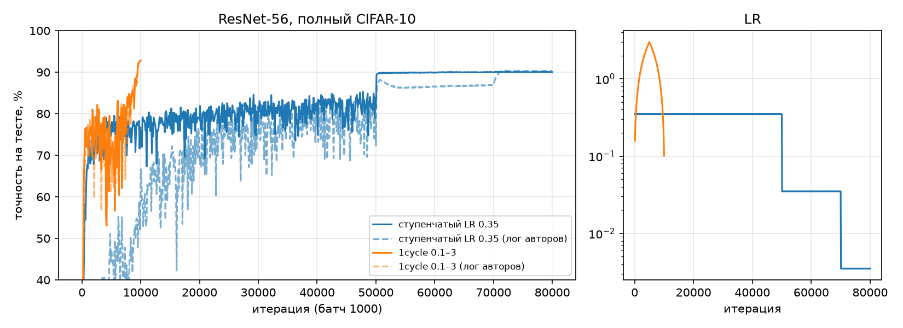
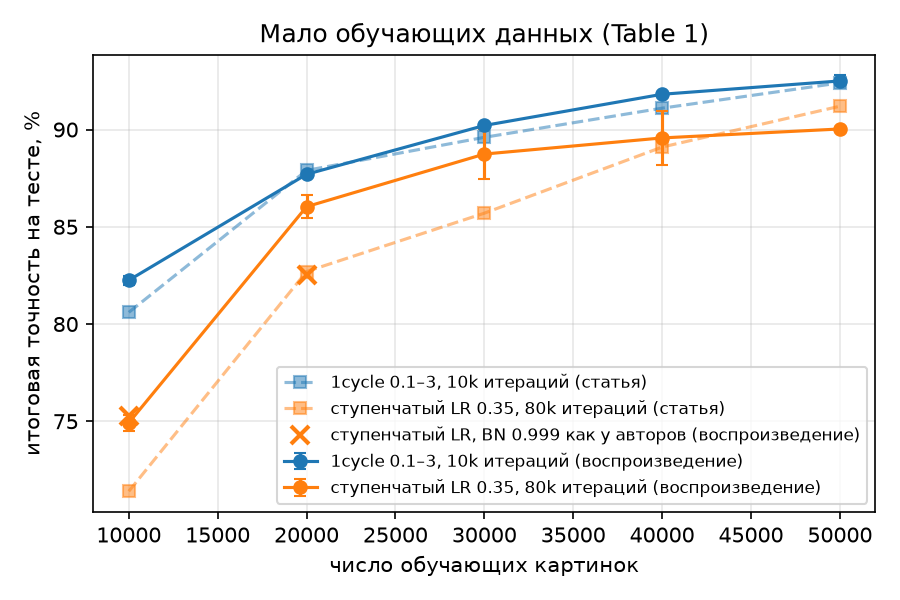

# Super-Convergence: воспроизведение

HW_2 Efficient Models. Статья: L. N. Smith, N. Topin, *Super-Convergence: Very Fast Training of Neural Networks Using Large Learning Rates* ([arXiv:1708.07120](https://arxiv.org/abs/1708.07120)).

- презентация: [presentation.pdf](presentation.pdf)
- отчет о воспроизведении: [report.pdf](report.pdf)
- код авторов (Caffe): https://github.com/lnsmith54/super-convergence

## Результаты

| Эксперимент | Воспроизведение | Статья |
|---|---|---|
| ResNet-56, CIFAR-10: 1cycle 0.1 → 3 → 0.1, 10k итераций (8 минут) | 92.5% (3 seed) | 92.4% |
| ResNet-56, CIFAR-10: ступенчатый LR, 80k итераций (57 минут) | 90.0% | 91.2% |
| 10k картинок: 1cycle / ступенчатый LR | 82.3% / 74.9% | 80.6% / 71.4% |
| DenseNet-40: 1cycle 100 эпох / ступенчатый LR 200 эпох | 92.6% / 92.2% | 92.2% / 92.1% |
| LeNet, MNIST: 1cycle 12 эпох / стандартный `inv` 85 эпох | 99.11% / 99.07% | 99.25% / 99.03% |
| wide ResNet-32: 1cycle 100 эпох / ступенчатый LR 800 эпох | 90.0% / 90.6% | 91.9% / 90.3% |
| оценка оптимального LR (Fig. 3a): по весам / по весам и статистикам BN, как в скрипте авторов | 0.1-0.8 / 3-7 | 2-6 |

- Главный результат повторился: один цикл с большим LR дает ту же точность за 8 раз меньше итераций.
- "В 8 раз быстрее" верно только против очень длинного бейзлайна авторов (1600 эпох).
- Выигрыш на малых данных подтвердился только на 10k картинок, слабый бейзлайн статьи объясняется настройкой BatchNorm.
- Оценка оптимального LR 2-6 из раздела 4 получается, только если сложить веса вместе со статистиками BatchNorm, как в скрипте авторов. По самим весам 0.1-0.8.





## Запуск

```
pip install -r requirements.txt
python train.py --schedule clr --lr-min 0.1 --lr 3 --iters 10000 --name clr_n50000
```

Вторая команда обучает ResNet-56 на CIFAR-10 с 1cycle. Остальные запуски из отчета делаются так же, через `train.py`, их параметры лежат в `results/<имя>.json` в поле `args`. Датасеты скачиваются сами в `data/`, логи пишутся в `results/`.
